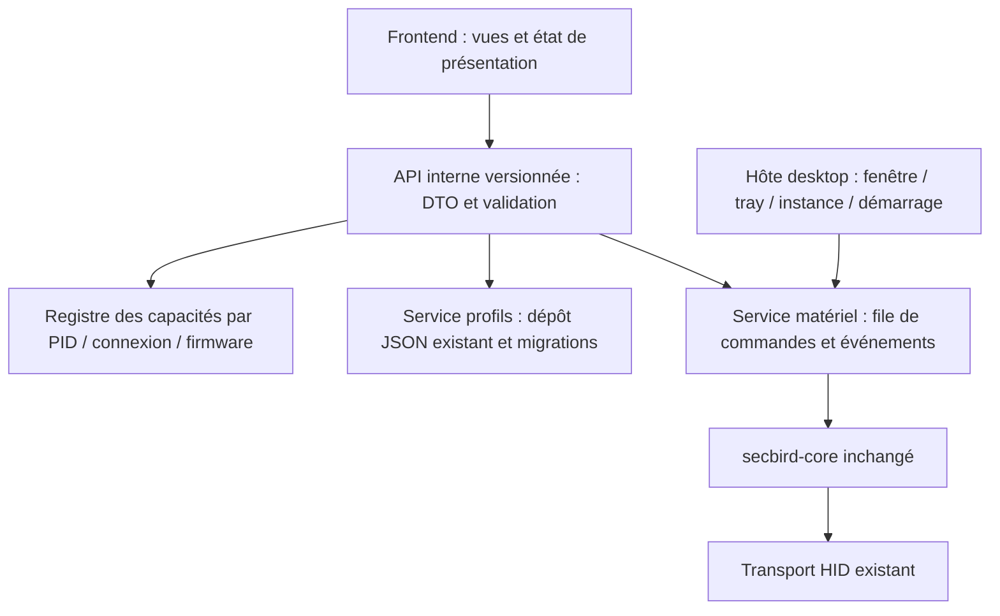

# Faisabilité et décision d'architecture

18 octobre 2026. Voir AUDIT.md pour les preuves locales. **Faisable sans réécriture du moteur ; fidélité pixel à pixel et compatibilité matérielle non démontrées.**

Précision de périmètre utilisateur du même jour : priorité au redesign léger, acceptation des deux modes (web en fenêtre ou fenêtre dédiée Tauri), sans campagne de tests matériels/backend. Une même UI statique sert les deux hôtes ; le moteur reste intact. Les benchmarks et validations de production ci-dessous sont conservés comme étapes ultérieures, pas comme prérequis bloquants du redesign.

Mise à jour de migration : les cinq familles d'appareils ont leurs vues de prototype ; fonctions non intégrées explicitement désactivées. Le registre déclaratif de types/modèles et les composants communs permettent d'ajouter un appareil sans copier une interface. Le menu tray utilise le même catalogue. Profils centralisés, barre conservée et avatar personnalisable. Les PNG produit sont définis uniquement par les développeurs dans ui/device-assets.js. Voir `prototype/COMPONENTS.md` pour le contrat d'extension et les limites de ce registre de démonstration, distinct d'un futur registre matériel validé.

**Correction utilisateur faisant foi :** la barre est conservée, seul le raccourci six points est supprimé ; avatar personnalisable et icône Profils locaux dans cette barre. Le catalogue est désormais un registre de présentation, pas la liste des appareils présents : celle-ci vient de l'énumération HID Windows réelle. La bibliothèque core est réutilisée sans son `discover` actif. Aucun GET/SET de protocole ni écriture matérielle. Les écrans affichent un état lecture seule et des brouillons locaux ; présence USB et prise en charge des réglages restent deux informations différentes.

## Desktop Windows

Priorité : Tauri 2 + WebView2, assets embarqués et commandes IPC typées. Rust core se conserve. Le tray Win32 actuel répond déjà à une partie du besoin (instance, auto-start, notifications), mais ouvre l'éditeur dans le navigateur : il ne peut pas satisfaire seul le besoin de fenêtre indépendante. Autre option : ajouter directement WebView2 au tray Win32 ; moins de changement du cycle de vie mais intégration COM, sécurité IPC et distribution runtime à maintenir. Tauri simplifie fenêtre/tray/IPC ; son coût réel reste à mesurer. React + TypeScript est compatible avec Tauri, mais facultatif : la première démo utilise JS/CSS sans dépendance UI pour rester exécutable hors ligne après compilation et limiter les variables. Migrer les composants en TS/React après validation visuelle, sans toucher au protocole.

Le prototype Tauri est **séparé du workspace Cargo existant** et réutilise secbird-core uniquement pour la base des modèles et la détection passive, sans pilote de réglages actif. Il doit fournir fenêtre centrée 1180×780, minimum 820×600, décorations Windows, resize natif, tray ouvrir/périphériques/quitter, option fermer vers tray, démarrage Windows optionnel et seconde instance ramenant la fenêtre. La fermeture finale doit passer par Quitter lorsque l'option tray est active. Les contrôles natifs sont provisoires ; une barre personnalisée fidèle nécessite tests clavier, DPI Windows, drag, snap et accessibilité. Le prototype n'est pas encore un fork matériel complet.

Distribution finale : EXE portable et/ou installeur EXE NSIS. WebView2 reste un runtime Microsoft propriétaire : code du fork open source, pas pile intégralement open source. Prévoir un installateur hors ligne du runtime, ou version fixe embarquée ; cela augmente fortement la taille. Ne pas utiliser le bootstrapper de téléchargement par défaut pour une installation sans Internet. Documentation : https://v2.tauri.app/distribute/windows-installer/ et https://v2.tauri.app/reference/config/ .

## Frontières recommandées

Extraire ensuite Engine dans un service sans dépendance UI ; une seule autorité possède les handles et sérialise les écritures. Fermer/détruire la WebView n'arrête pas le service matériel, les profils par application ou les événements. Masquer la fenêtre ne libère pas nécessairement les processus WebView2 : distinguer masquage et destruction/recréation. Un futur frontend invoque des opérations métier, jamais des octets HID. Conserver ancien CLI/tray comme référence et voie de retour pendant la migration.

API envisagée : listDevices, getCapabilities, getSnapshot, listProfiles, saveProfileDraft, activateProfile, subscribeEvents. Erreurs structurées (unsupported, disconnected, timeout, permission), révisions de profils, annulation et coalescence des sliders. Version DTO indépendante du format de profils. Ne pas envoyer une commande à chaque mouvement de slider. Backups et migration additive du Store existant, sans écraser profiles.json depuis la démo.

Chaque capacité contient status (unknown/declared/verified/unsupported), read/write, limites, provenance, transport, firmware testé et raison d'indisponibilité. Intersection DB + restrictions de connexion + preuves validées. **Unknown refuse les écritures par défaut**. L'UI masque les réglages absents et affiche les motifs ailleurs ; l'API revalide toute demande, même si l'UI a caché le contrôle. Mémoire embarquée distincte des profils locaux. Pas de mode production activable dans la démo.

## Référence visuelle Synapse 4

**Décision utilisateur faisant foi : conserver l'identité de Secbird.** La référence Synapse concerne la disposition et les habitudes de navigation ; le vert Razer n'est pas repris. HOME utilise désormais le thème Bridge du code amont (#ff5412, #050505, #0d0d0e, #131314) et le logo Secretarybird. Les descriptions de palette verte et de rendus originaux plus bas sont historiques et remplacées : dessins produits supprimés, photos stock souris/clavier temporaires et ressources restantes en attente. Crédit et licence de chaque photo dans `prototype/ui/assets/CREDITS.md`, fichiers locaux, aucune requête distante à l'exécution.

Mise à jour HOME : quatre captures utilisateur reçues dans `references/synapse4/HOME/`. Elles remplacent les hypothèses du premier prototype pour ces vues. Navigation supérieure retenue, rail masqué dans HOME, cartes 220 px sur quatre colonnes à 1280 px, fond #222 et cartes #111, accent #40d421. Barre supérieure 38 px, outils 40 px et navigation 44 px, suivis d'une bordure de 2 px. Le rail est temporairement conservé dans les anciennes pages périphériques hors HOME. Les tableaux de dimensions initiaux ci-dessous décrivent la première itération, pas le HOME révisé.

Dashboard, Gamer Room, Devices & Modules et Global Shortcuts sont accessibles. Les visuels produit sont des SVG originaux ; la scène Gamer Room est dessinée en CSS. Pas d'intégration Alexa, Exchange, import propriétaire ou Gamer Room. Les champs simulés sont identifiés et les contrôles d'installation désactivés. La barre de titre personnalisée remplace désormais les décorations Windows dans le prototype Tauri ; les actions de fenêtre passent par les API natives autorisées.

Références publiques consultées, aucun asset redistribué :

- Guide officiel Basilisk V3 Pro 35K : https://dl.razerzone.com/master-guides/RazerSynapse4/BASILISKV3PRO35K-00000214-en.pdf (38 pages ; extraction texte presque vide. Pages rendues localement pour étude uniquement : 12, 13, 16, 21–24, 27 ; aucune capture propriétaire ajoutée à la distribution).
- Guide officiel Pro Type Ergo, sections Synapse, Customize et Lighting : https://dl.razerzone.com/master-guides/RazerSynapse4/PROTYPEERGO-00000708-en.pdf (pp. 12–22 ; modèle différent, référence de navigation seulement).
- https://mysupport.razer.com/app/answers/detail/a_id/13862/ (configuration Lighting ; page complète bloquée par redirection, extrait de recherche uniquement).
- https://www.razer.com/newsroom/product-news/introducing-razer-synapse-4 (présentation officielle ; ne prouve aucune performance de notre fork).

Le guide Pro Type décrit onglets, navigation précédent/suivant, accès aux périphériques/modules et profils, Customize et luminosité dans Lighting. Le guide Basilisk montre un bandeau supérieur de navigation, des sous-onglets centrés en forme de pilule, un sélecteur de profil à gauche et la batterie à droite. Dashboard utilise de petites cartes ; Customize place la souris au centre avec des repères latéraux ; Performance aligne cinq stages avec sliders dans un panneau et polling dans un panneau voisin ; Lighting sépare luminosité/extinction et effets. La démo conserve pour l'instant un rail permanent comme demandé au brief initial : c'est un écart explicite au guide étudié. Les couleurs/dimensions ci-dessous sont des choix de conception, pas une extraction exacte. Les menus déroulants, survols et animations ne peuvent pas tous être déduits de captures statiques. La fidélité pixel à pixel reste à valider sur une version cible déterminée.

| Élément | Spécification du prototype (choix de conception, pas métrique extraite) |
|---|---|
| Dashboard | grille de cartes périphériques, état simulé, batterie, accès direct |
| Navigation | rail gauche 216 px, bandeau 52 px, sous-navigation Customize/Performance/Lighting |
| Personnalisation | schéma original CSS souris, zones numérotées et liste d'affectations |
| Performance | cinq stages DPI, stage actif vert, slider et saisie numérique, polling limité par capacités fictives |
| Lighting | luminosité, couleur et effet locaux ; aucune synchronisation Chroma |
| Profils | sélecteur par appareil, création/renommage/suppression ; mémoire embarquée annoncée indisponible |
| Palette | fonds #111/#191919/#222, contour #353535, texte #eee, secondaire #999, accent #44d62c |
| Typographie | Segoe UI système avec repli sans-serif, corps 13–14 px, titres 24 px ; aucune police Razer |
| Rythme | espaces 8/16/24/32 px, contrôles 36 px, panneaux à bordure fine |
| États | hover éclairci, focus clavier vert visible, actif souligné, disabled atténué, transitions 120 ms et reduced-motion |
| Fenêtre | 1180×780 initial, min 820×600 ; défilement interne et grille adaptative |

Assets : silhouettes originales en CSS, aucun logo Razer ni photo produit. Marques utilisées uniquement pour identifier les modèles, mention d'indépendance. Pour augmenter la fidélité, créer des rendus originaux légalement documentés et mesurer dimensions/états sur captures autorisées.

## Mémoire et CPU

Ne pas reprendre les 12 MB du README comme mesure du fork. Mesurer au moins cinq séries après 30 s de chauffe, 60 s par état, même PC/Windows/DPI/runtime et build release :

1. fenêtre ouverte inactive ;
2. fenêtre masquée dans le tray ;
3. WebView détruite, moteur seul actif (future intégration ; pas de matériel dans la démo).

Additionner working set et private bytes du parent et de tous ses descendants, y compris renderer/GPU/utilitaires msedgewebview2, sans englober d'autres applications. CPU calculé sur delta de temps CPU et durée, rapporté aussi au nombre de cœurs logiques. Mesurer démarrage, transitions et reconnexion ; séparer pics, médiane et p95. `prototype/scripts/measure.ps1` prépare ce relevé pour une instance native. Même protocole sur Secbird et Synapse 4 si installé ; ne pas lancer leurs moteurs en parallèle sur le même matériel. Désactiver sorties réseau et vérifier avec les outils Windows avant publication.

Objectifs de travail à valider : aucune activité UI périodique au repos, pas d'animation perpétuelle, aucun polling HID depuis le frontend. La démo fournit état 3 sans moteur réel : **mesure du futur moteur actif encore requise**. Aucun résultat RAM/CPU desktop à annoncer tant que le binaire release n'a pas été exécuté.

## Conditions de passage au matériel

Rapports séparés USB/2,4 GHz, PID/interface/firmware/récepteur et opérations réellement vérifiées. Commencer par inventaire passif, puis lectures documentées après accord explicite, et seulement ensuite réglages déjà validés. Interdire commandes arbitraires, firmware et macros flash dans cette mission. Maintenir la couverture existante, tester déconnexion/reprise, changement de profil et absence d'écriture sur capacités inconnues avant toute intégration.
