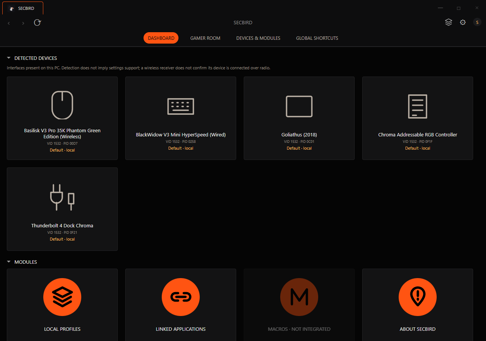

# Secbird desktop UI proposal

An isolated, offline Windows frontend prototype for Secretarybird. It explores a familiar device dashboard and reusable configuration pages while retaining Secbird's orange Bridge palette, logo, credits and existing hardware engine. It does not replace the current application or modify its Cargo workspace.



## Current behavior

- Dedicated Tauri 2 / WebView2 window, centered at first launch, 1180 x 780 with an 820 x 600 minimum; custom title bar, resizing and single-instance behavior.
- System tray with open, detected devices, release interface and quit actions. Optional close/minimize to tray and Windows startup preferences.
- Real, passive Razer HID enumeration, reused from `secbird-core` and its device database. Multiple interfaces are grouped using PID and Windows Container ID, with serial/PID fallbacks. The dashboard and tray never substitute simulated devices when discovery fails or returns an empty list.
- Reusable cards, panels, tabs and category icons, with declarative model/type definitions. Developer-supplied transparent PNGs can replace the icons centrally.
- Central local profile drafts: create, duplicate, rename, activate locally, delete, JSON import/export and saved application associations. Drafts are separate from Secbird's existing profile store and onboard memory.
- English by default, an offline translation module with separate dictionaries, and a customizable local text/image avatar. No account, telemetry, Razer service or remote runtime asset.

**Hardware configuration is not integrated.** Detected-device settings remain disabled/read-only. No protocol feature reports, experimental HID commands, firmware changes, battery queries or profile application are performed. A visible wireless receiver does not prove its device is connected over radio. Current battery levels and hardware settings are not displayed as if they had been read.

The mouse, keyboard, mousepad, dock and ARGB pages are a visual starting point. Keyboard remapping, macros, advanced wheel features, pairing, calibration, audio, onboard slots, ARGB configuration and application-triggered profile switching are not connected in this frontend. Existing backend functions are retained in the original application.

## Build and run on Windows

Requires Node/npm, stable Rust MSVC, Visual Studio C++ build tools and Microsoft WebView2. Dependency installation requires network access; the built interface runs offline.

```powershell
cd prototype
npm ci
npm run build
.\src-tauri\target\release\secbird-desktop-demo.exe
```

`npm run dev` opens the dedicated desktop window. `npm run bundle` uses the NSIS configuration with an offline WebView2 installer; that installer has not been validated or published. Release executables and local build tools are excluded from Git.

For optional browser mode, build the Windows EXE first and run `npm run web`. Open `http://127.0.0.1:4173`. The loopback-only server serves the same UI and exposes a read-only discovery endpoint which executes the fixed local EXE with `--list-devices`. Windows lifecycle preferences are unavailable in browser mode. Opening `ui/index.html` directly displays the shell but cannot discover devices.

The tray process remains alive when its window is hidden or destroyed. This prototype does **not** yet host a continuously active hardware engine, so that behavior is not evidence of background hardware functionality.

## Extension points

| File | Responsibility |
|---|---|
| `ui/device-registry.json` | Model/type presentation definitions and page composition; not a list of connected devices |
| `ui/registry.js` | Match actual discovery results to model templates by PID |
| `ui/components.js`, `ui/devices.js` | Shared components and reusable page renderers |
| `ui/device-assets.js` | Developer-owned transparent PNG configuration by model/PID |
| `ui/model.js` | Separate local draft profiles, validation and migration |
| `ui/i18n.js`, `ui/locales/` | Offline translations, with English fallback |
| `src-tauri/src/discovery.rs` | Passive discovery; no protocol settings commands |
| `src-tauri/src/main.rs` | Native window, tray, preferences and lifecycle |

`npm run prepare:ui` generates `ui/device-registry.js` from the JSON catalogue; development/build commands run it automatically. Capability declarations do not prove hardware support. Future hardware integration must validate capabilities before enabling settings.

See [COMPONENTS.md](COMPONENTS.md), [LOCALIZATION.md](LOCALIZATION.md), [product image instructions](ui/assets/devices/README.md), [audit](../AUDIT.md), [feasibility](../FEASIBILITY.md) and [roadmap](../ROADMAP.md). The audit/history documents are currently in French; this README summarizes the current state for reviewers.

## Validation and remaining work

`npm run check` validates the local profile model and checks that discovery cannot send hardware settings commands. `node scripts/preview-live.cjs`, with the local server running, checks the connected-device UI on the development machine, empty discovery results, read-only settings, navigation, avatar persistence, English/translation fallback and compact layout. This is a machine-specific smoke check, not a general hardware compatibility test.

Windows release builds and UI smoke checks passed locally. Five device/receiver models were observed: Basilisk V3 Pro 35K Phantom Green Edition, BlackWidow V3 Mini HyperSpeed, Goliathus, Thunderbolt 4 Dock Chroma and Chroma Addressable RGB Controller. This establishes USB enumeration only, not command compatibility.

RAM/CPU benchmarks have **not** been performed. `scripts/measure.ps1` supports future measurements of the parent process and WebView2 descendants in open-idle, tray-hidden and interface-destroyed states. Comparing only the Rust process would undercount memory. No claim of measured superiority to Synapse is made.

Next steps are maintainer design feedback, accessibility/high-DPI checks, lifecycle validation, resource measurements and a separately reviewed integration with the existing engine/profile service. React/TypeScript is optional; this proposal uses plain JavaScript/CSS to avoid adding a UI framework before the design is agreed.

## Licensing and assets

The original MIT/Apache-2.0 licensing, `NOTICE` and author credits are preserved. Secbird's bundled logo and native icon are reused unchanged. Standard category/navigation icons are code-native; future product PNGs need appropriate provenance. No proprietary Synapse code or captured UI assets are bundled. Reference screenshots remain local and ignored by Git. See [asset credits](ui/assets/CREDITS.md).
